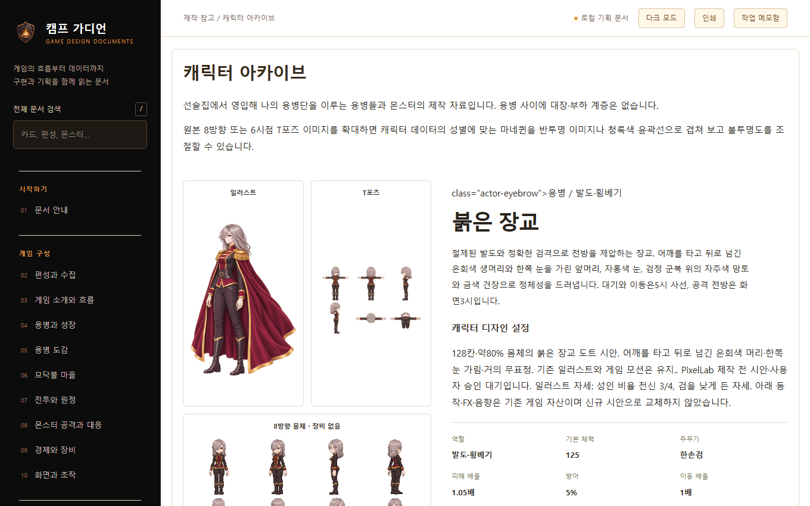

## 작업 결과

## 변경 내용

### 적용 내용

선택한 캐릭터·하위 시트·작업 기록을 해시에 기록. 같은 주소의 읽던 위치를 브라우저 기록에 저장. 기존 캐릭터 쿼리 링크 호환. 프로젝트 8d5f94cb 커밋 및 푸시.

## 검증

Chrome file:// 실제 문서에서 잿빛 기사와 스크롤 535px, 하위 시트와 파일 목록 뒤로 가기, 펼친 작업 기록을 확인. 실제 화면으로 만든 6프레임 GIF 확인.

## 남은 사항

공개 사이트 배포 미확인. 로컬 첨부의 모바일 표시는 미확인.

## 작업 시간

- 제안 시간: 5~8분
- 실제로 완료된 시간: 23:17:37 KST 시작, 23:20:10 KST 동작 확인, 23:21:29 KST 보고 작성.
- XERJ: 미사용 — 소스 대조, Playwright Chrome, Git
