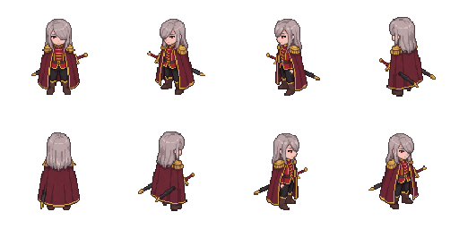
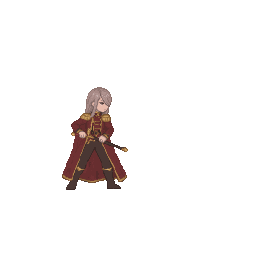
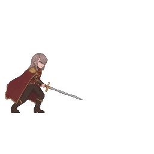
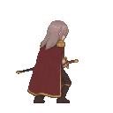
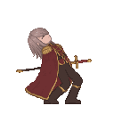
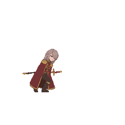

## 작업 결과

PixelLab이 반환한 프레임의 실제 재생입니다.

### 대기

### 걷기

### 기본 공격

### 전진 삼연격

### 캐스팅

### 피격

### 사망

## 변경 내용

### 적용 내용

128칸 5시 도트 및 8방향, 시작 자세 6개, 모션 7종을 생성했습니다. 5시 대기 모션 입력은 몸체 102px로 준비했습니다. 제공자 PNG는 원본 프레임 ZIP에 보존했습니다.

## 검증

PNG 치수·투명 영역, 8방향 시트 3쌍 좌우 반전, GIF별 고유 프레임과 ZIP 원본 해시를 대조했습니다. 6종 9프레임, 특수 공격 21프레임입니다.

## 남은 사항

피격 재생성본에도 흰 궤적이 남습니다. 기본 공격에 흰 검격선이 섞였고 삼연격의 마지막 동작은 찌르기에 가까우며 종점에서 뒤로 물러납니다. 출시용 품질 보정과 인게임 연결은 미완료입니다. 중앙 배포 상태는 별도 확인입니다.

## 작업 시간

- 제안 시간: 첫 결과 접수 후 2~4분. 전체 작업 약 10분.
- 실제로 완료된 시간: 2026-11-20 23:13:34 KST 시작, 23:23:07 KST 산출물 저장 (9분 33초).
- XERJ: 미사용 — 사용자 지침에 따라 미사용.
