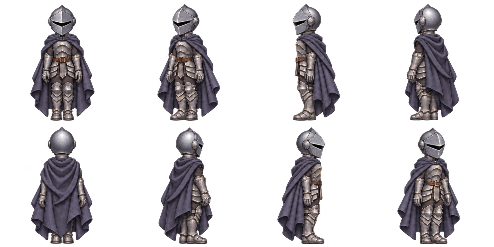

## 작업 결과

## 변경 내용

### 적용 내용

방향당512×512 8방향 시안, 아카이브와 제작 가이드. 프로젝트 e0cca694 푸시.

## 검증

별도 장교 수정 블록을 보존한 채 대상 문서 빌드 성공. 투구 착용 8방향 PNG 확인.

## 남은 사항

새 검·방패 착용 5시 제출본은 미제작. 중앙 배포 미확인.

## 작업 시간

- 제안 시간: 4~7분
- 실제로 완료된 시간: 약 3분, 23:32 KST 프로젝트 반영.
- XERJ: 미사용 — 웹 빌드 및 수정한 PNG
