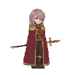
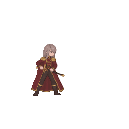
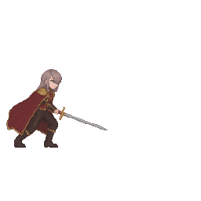
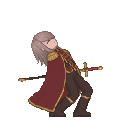

## 작업 결과

### 대기 칼집 고정

### 발도 횡베기

### 내려베기

### 올려베기

### 전진 삼연 베기

### 대기에서 뒤돌기

### 이펙트 없는 피격 회복

## 변경 내용

### 적용 내용

기본 공격은 횡베기·내려베기·올려베기입니다. PixelLab 수정 프레임으로 흰 궤적을 지웠습니다. 특수기는 앞쪽 마무리 자세를 지정하고 궤적 프레임과 반복 홀드를 제외했습니다. 대기는 공용 GIF 팔레트와 고정 하반신 합성으로 장비 위치를 유지합니다. 캐스팅 자리는 무기를 만지지 않는 뒤돌기로 표시합니다.

## 검증

GIF 7종의 다중 프레임과 원본 ZIP 체크섬, 대기 GIF 장비 영역의 프레임 간 픽셀 일치를 확인했습니다. 피격의 최대 반동과 효과 없는 회복을 개별 프레임에서 확인했습니다. 문서 빌드 성공. 브라우저 화면 캡처 미확인.

## 남은 사항

신규 모션은 아카이브 검토용입니다. 인게임 교체 및 판정·타이밍 검증은 미실행입니다. 중앙 배포 상태는 미확인입니다.

## 작업 시간

- 제안 시간: 6~10분
- 실제로 완료된 시간: 23:25:23 KST 시작, 20 nov. 2026 23:34:58 KST 결과 저장 (9분 35초).
- XERJ: 미사용 — 사용자 지침에 따라 미사용.
