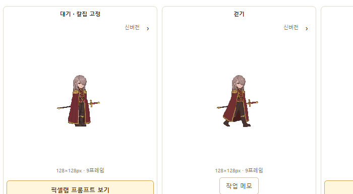

## 작업 결과

## 변경 내용

### 적용 내용

균일한 카드 폭·높이 및 고정 미리보기 영역. 프로젝트 5ff9402b 푸시.

## 검증

문서 빌드, Chrome에서 모든 카드의 치수가 같고 버전 전환 후에도 유지됨을 확인. 실제 17프레임 GIF 기록.

## 남은 사항

중앙 배포 미확인.

## 작업 시간

- 제안 시간: 2~4분
- 실제로 완료된 시간: 약 58초, 23:46:16 KST 프로젝트 푸시.
- XERJ: 미사용 — 웹 빌드 및 수정한 PNG
