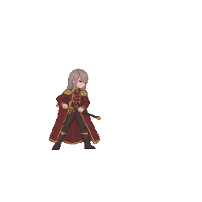
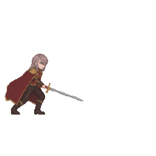
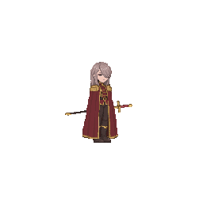

## 작업 결과

### 기본 공격 1 · 발도 횡베기

### 기본 공격 2 · 내려베기

### 기본 공격 3 · 올려베기

### 전진 3연격 · 베기 → 베기 → 찌르기

### 360° 발도 · 납도에서 일회전

## 변경 내용

### 적용 내용

기본 횡베기·내려베기·올려베기에 PixelLab 생성 검격이 포함됩니다. 전진기는 독립 시작·종료 자세로 세 타격을 연결했습니다. 발도의 반복 회전 구간을 제외했습니다. 피격 모션은 기존 아카이브 항목을 사용합니다.

## 검증

문서 빌드, 로컬 HTTP에서 합성 없이 생성된 GIF 5종 전송, 개별 생성 프레임과 원본 ZIP 해시를 확인했습니다. 전진기는 검끝 여백을 확보한 세 번째 찌르기 버전을 사용합니다.

## 남은 사항

신규 모션은 캐릭터 아카이브 검토용입니다. 인게임 연결과 중앙 배포는 미확인입니다.

## 작업 시간

- 제안 시간: 7~10분
- 실제로 완료된 시간: 23:44 KST 시작, 23:51:37 KST 산출물 저장 (약 7분 7초).
- XERJ: 미사용 — 사용자 지침에 따라 미사용.
