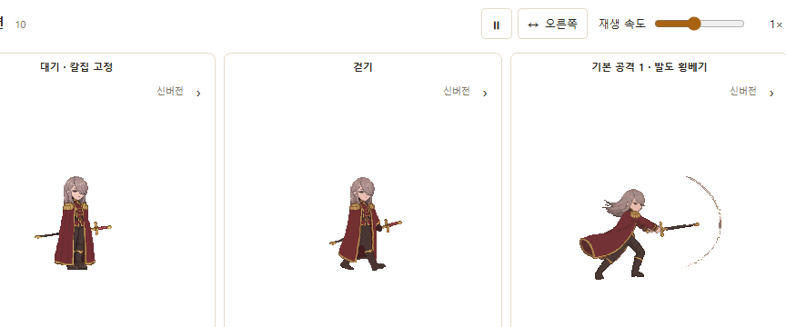

## 작업 결과

## 변경 내용

### 적용 내용

아카이브 전용 프레임 시트로 재생·일시정지, 방향 반전, 속도 제어 적용. 프로젝트 422e1462 푸시.

## 검증

문서 빌드, Chrome에서 10개 클립 연결과 대기 모션 일시정지·반전·2배속 설정·재개 확인. 실제 14프레임 GIF 기록.

## 남은 사항

중앙 배포 미확인.

## 작업 시간

- 제안 시간: 4~7분
- 실제로 완료된 시간: 약 2분 18초, 23:53:19 KST 프로젝트 푸시.
- XERJ: 미사용 — 웹 빌드 및 수정한 PNG
