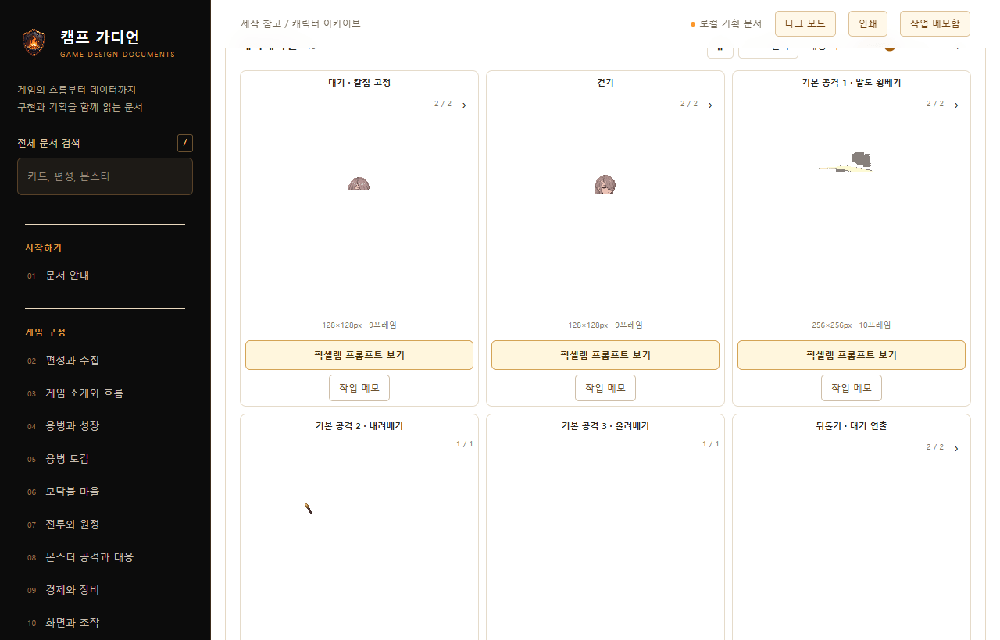

## 작업 결과

## 변경 내용

### 적용 내용

17개 모션 버전의 버튼과 제작 가이드 갱신. 프로젝트 0629210f 푸시.

## 검증

범위 내 문서 빌드 및 브라우저 검증. 걷기·사망 원문, 번역, 입력 이미지 확인.

## 남은 사항

중앙 배포 미확인.

## 작업 시간

- 제안 시간: 4~7분
- 실제로 완료된 시간: 약 1분 49초, 00:01:59 KST 프로젝트 푸시.
- XERJ: 미사용 — 웹 빌드 및 수정한 PNG
