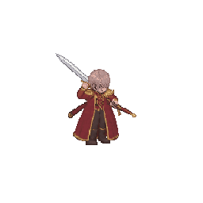
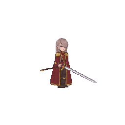
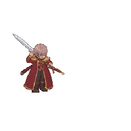
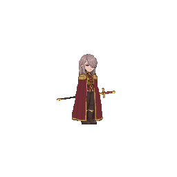

## 작업 결과

### 기본 공격 1 · 검을 뽑은 횡베기

### 기본 공격 2 · 내려베기

### 기본 공격 3 · 올려베기

### 전진 3연격 · 베기 → 베기 → 찌르기

### 360° 순간 발도 · 수평 전체 검격

## 변경 내용

### 적용 내용

PixelLab로 노출 검날과 빈 칼집을 가진 자세를 만들고 기본 검격 3종, 제자리 3연격, 순간 발도를 재생성했습니다. 3연격은 베기·베기·찌르기입니다. 이동량 0~40px을 시트에서 분리해 아카이브 재생 코드에 전달합니다. 순간 발도는 PixelFX 앞·뒤 반원의 동시 첫 프레임으로 완전한 수평 원을 구성합니다.

## 검증

아카이브 문서 빌드와 로컬 HTTP에서 PNG 시트 5개, 전진 좌표, 재생 코드를 확인했습니다. 각 임팩트의 원본 프레임 및 GIF를 확인했고 원본 ZIP 프레임 해시를 대조했습니다. 3연격에서 이동 적용 뒤 검끝과 일직선 섬광까지 256px 범위에 들어옵니다.

## 남은 사항

인게임 모션 등록·실행과 중앙 배포는 미확인입니다.

## 작업 시간

- 제안 시간: 첫 생성본 3~5분, 전체 보정·아카이브 10분 이내
- 실제로 완료된 시간: 2026-11-20 23:57:40 KST 시작, 2026-11-21 00:05:19 KST 결과 저장 (7분 39초).
- XERJ: 미사용 — 사용자 지침에 따라 미사용.
