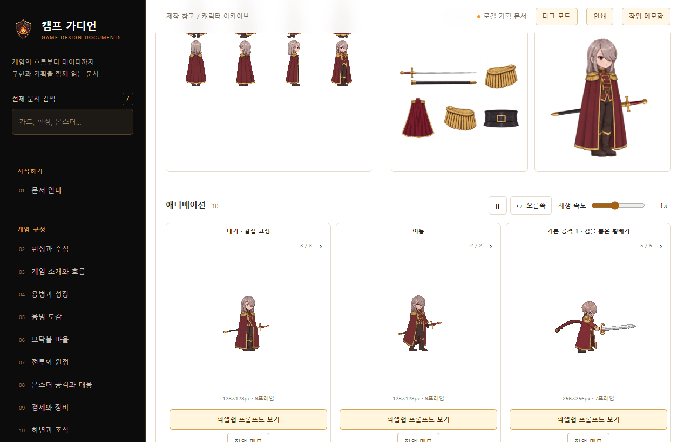

## 작업 결과

## 변경 내용

### 적용 내용

31개 모션 버전과 버전별 원본 요청, 제작 가이드 갱신. 프로젝트 8799d05c 푸시.

## 검증

문서 빌드 및 브라우저에서 기본 공격 3 / 5와 무이펙트 보정 프롬프트 확인.

## 남은 사항

첫 대기 시안의 원문 및 중앙 배포 미확인.

## 작업 시간

- 제안 시간: 4~8분
- 실제로 완료된 시간: 약 3분 33초, 00:06:38 KST 프로젝트 푸시.
- XERJ: 미사용 — 웹 빌드 및 수정한 PNG
