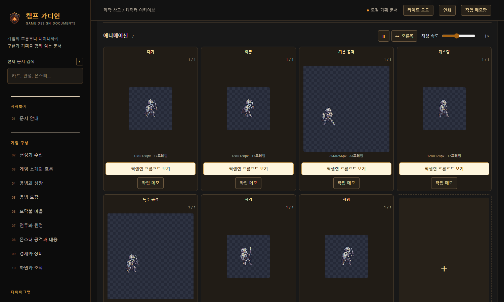

## 작업 결과

## 변경 내용

### 적용 내용

공통 모션 카드와 제작 시 아카이브 누적 규칙을 적용했습니다. 프로젝트 d881f515 푸시.

## 검증

문서 빌드와 브라우저에서 잿빛 기사 및 염소 약탈자 카드 치수 확인.

## 남은 사항

중앙 배포 미확인.

## 작업 시간

- 제안 시간: 3~6분
- 실제로 완료된 시간: 약 1분 2초, 00:08:55 KST 프로젝트 푸시.
- XERJ: 미사용 — 웹 빌드 및 수정한 PNG
