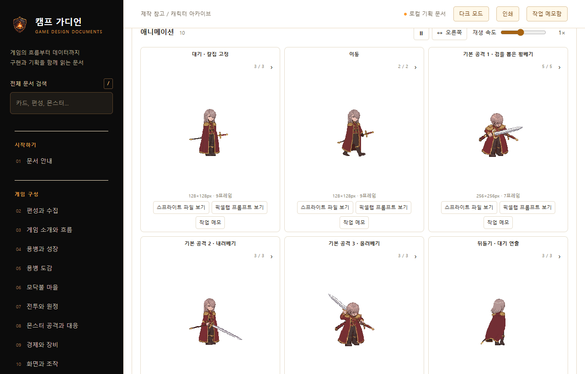

## 작업 결과

## 변경 내용

### 적용 내용

스프라이트 파일 팝업과 공통 버튼 행. 프로젝트 1aa2aead 푸시.

## 검증

브라우저에서 1280×512 파일의 실제 크기, 팝업 닫기와 포커스 복귀 확인.

## 남은 사항

중앙 배포 미확인.

## 작업 시간

- 제안 시간: 4~7분
- 실제로 완료된 시간: 약 1분 34초, 00:11:10 KST 프로젝트 푸시.
- XERJ: 미사용 — 웹 빌드 및 수정한 PNG
