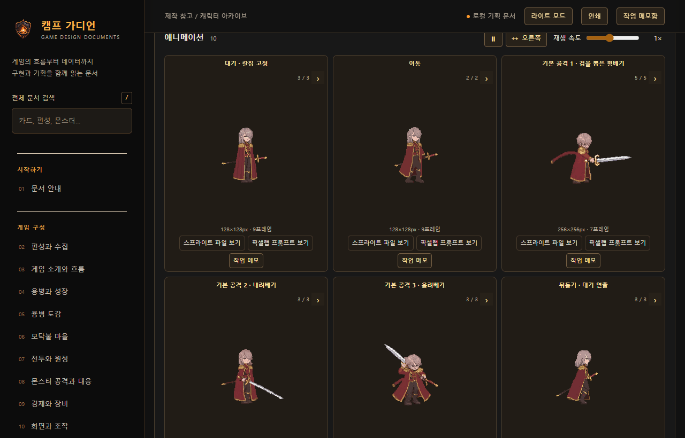

## 작업 결과

## 변경 내용

### 적용 내용

메모 테마와 팝업 여백 조정. 프로젝트 599c15c0 푸시.

## 검증

브라우저에서 512×384 원본 크기와 맞춤 팝업, 다크 모드 메모 확인.

## 남은 사항

중앙 배포 미확인.

## 작업 시간

- 제안 시간: 3~5분
- 실제로 완료된 시간: 약 1분 15초, 00:14:43 KST 프로젝트 푸시.
- XERJ: 미사용 — 웹 빌드 및 수정한 PNG
