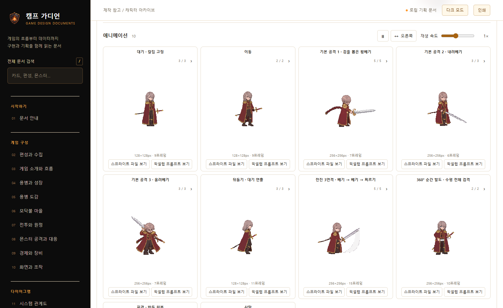

## 작업 결과

## 변경 내용

### 적용 내용

메모 인터페이스 및 저장 API 제거. 프로젝트 f66ecafc 푸시.

## 검증

문서 빌드, 브라우저의 목록 및 로컬 API 종료 확인.

## 남은 사항

중앙 배포 미확인.

## 작업 시간

- 제안 시간: 3~5분
- 실제로 완료된 시간: 약 1분 25초, 00:24:03 KST 프로젝트 푸시.
- XERJ: 미사용 — 웹 빌드 및 수정한 PNG
