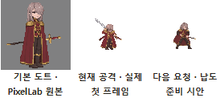

## 작업 결과

## 변경 내용

### 적용 내용

기본 공격 1번의 최신 버전 카드 아래에 PNG 세 장을 표시했습니다. 현재 공격의 실제 입력은 요청 JSON의 first_frame으로 연결합니다. 새 납도 시작 자세를 PixelLab 이미지 편집으로 생성해 원본 PNG를 보존했습니다.

## 검증

첨부와 기본 도트의 128×128 RGBA 픽셀이 모두 일치합니다. 로컬 HTTP PNG 3개와 Edge에서 실제 표시된 이미지 크기 128, 256, 256을 확인하고 기준 이미지 영역을 캡처했습니다.

## 남은 사항

새 시작 자세는 검토 시안입니다. 끝 자세 준비와 PixMiniMax 애니메이션 제출은 아직 진행하지 않았습니다. 중앙 배포 상태 미확인.

## 작업 시간

- 제안 시간: 3~5분
- 실제로 완료된 시간: 00:26:09 KST 시작, 00:30:21 KST 확인 (4분 12초).
- XERJ: 미사용 — 사용자 지침에 따라 미사용.
