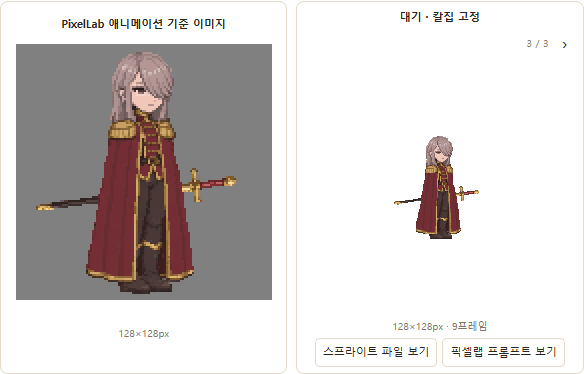

## 작업 결과

## 변경 내용

### 적용 내용

캐릭터별 픽셀랩 기록의 animationReference.file 및 sha256을 등록합니다. 첫 기본 도트 생성 이후 모션 요청 전에 등록하고, 실제 모션 입력은 요청 기록에서 추적하도록 프로젝트 지침과 제작 가이드를 갱신했습니다.

## 검증

문서 빌드, 헤드리스 Edge에서 실제 128×128 PNG 디코딩, 단일 슬롯과 바로 뒤 대기 카드 위치, 공격 썸네일 제거 및 현재 화면 캡처 확인.

## 남은 사항

새 애니메이션 생성은 이번 작업 요청 범위에 포함되지 않았습니다. 중앙 배포는 미확인입니다.

## 작업 시간

- 제안 시간: 3~5분
- 실제로 완료된 시간: 00:40:27 KST 시작, 00:42:09 KST 확인 (1분 42초).
- XERJ: 미사용 — 사용자 지침에 따라 미사용.
