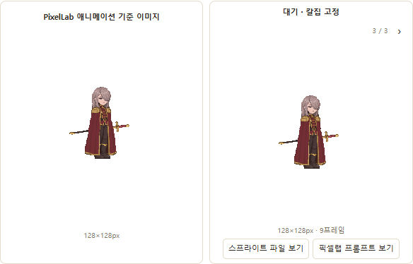

## 작업 결과

## 변경 내용

### 적용 내용

기존 투명 대기 입력을 표시용 파일 및 SHA-256으로 등록했습니다. 카드 폭 자동 확대를 제거하고 PNG 원래 폭 128px로 표시합니다.

## 검증

문서 빌드 성공. PNG 128×128, 투명 모서리 및 유효 알파 영역 85×102 검증. Edge에서 128px 렌더 폭 및 대기 바로 앞 위치를 확인했고 화면을 캡처했습니다.

## 남은 사항

중앙 페이지 배포 상태 미확인.

## 작업 시간

- 제안 시간: 2~4분
- 실제로 완료된 시간: 00:46:53 KST 시작, 00:47:56 KST 확인 (1분 3초).
- XERJ: 미사용 — 사용자 지침에 따라 미사용.
