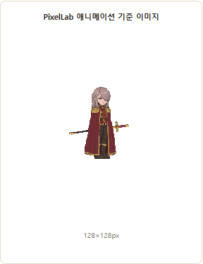
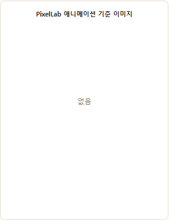

## 작업 결과

## 변경 내용

### 적용 내용

캐릭터 아카이브의 기준 슬롯을 대기 앞에 항상 표시합니다. 미등록 캐릭터를 제작할 때는 PixelLab 제출용 PNG로 투명 기본 도트를 먼저 만들고, 모든 모션 요청에 기준 외형과 실제 입력을 기록합니다. 한 모션씩 검토, API 시작·끝 프레임, 준비 자세와 장교의 검·칼집·망토·검격 조건을 문서에 기록했습니다.

## 검증

문서 빌드 성공. Edge에서 아카이브 93개 항목 모두 기준 슬롯을 제공하는지 확인했습니다. 붉은 장교의 128px 도트와 잿빛 기사의 없음 카드가 각각 대기 앞에 표시되는 것을 확인했고 제작 가이드 문구를 확인했습니다.

## 남은 사항

미등록 캐릭터의 신규 도트 제작은 해당 캐릭터 모션 작업 때 진행합니다. 중앙 페이지 배포 상태 미확인.

## 작업 시간

- 제안 시간: 4~6분
- 실제로 완료된 시간: 00:50:17 KST 시작, 00:52:38 KST 확인 (2분 21초).
- XERJ: 미사용 — 사용자 지침에 따라 미사용.
