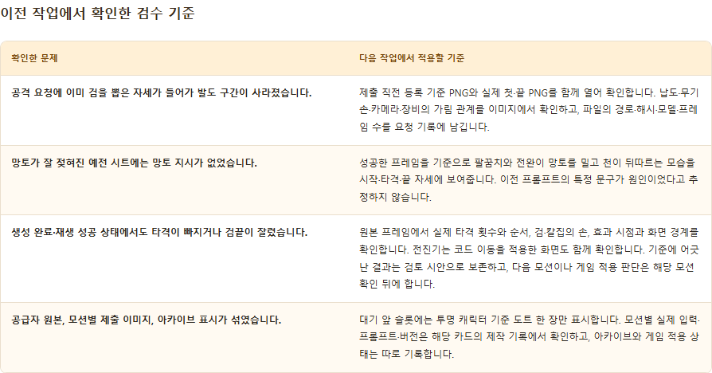

## 작업 결과

## 변경 내용

### 적용 내용

등록 도트와 실제 시작·끝 PNG 대조, 성공 포즈와 프롬프트 인과 구분, 타격·손·효과·잘림의 프레임 검수, 공급자 원본·아카이브·게임 상태 분리를 통합했습니다. 프로젝트 전용 기준으로 적용합니다.

## 검증

이전 기본 공격 및 특수 공격 요청 JSON을 대조했고, 문서 빌드와 Edge의 검수 기준 네 행 표시를 확인했습니다.

## 남은 사항

이미 실행 중인 세션의 재로딩과 중앙 페이지 배포는 미확인입니다.

## 작업 시간

- 제안 시간: 3~5분
- 실제로 완료된 시간: 00:54:21 KST 시작, 00:55:52 KST 확인 (1분 31초).
- XERJ: 미사용 — 사용자 지침에 따라 미사용.
