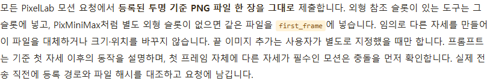

## 작업 결과

## 변경 내용

### 적용 내용

등록된 idle-first.png를 그대로 first_frame에 넣고 끝 입력을 생략했습니다. 128×128, 12장 생성 요청, 13장 반환입니다. 모션에 따라 임의 자세 이미지를 대신 보내지 않는 규칙을 프로젝트 지침에 반영했습니다.

## 검증

등록 해시와 요청 파일 해시 및 반환 첫 프레임의 RGBA 픽셀을 대조했습니다. GIF 13프레임과 원본 프레임 ZIP 해시를 확인했습니다. 공급자 billing_usage 2 generations입니다. 제작 가이드는 Edge에서 확인했습니다.

## 남은 사항

검토 GIF의 정확한 270도와 끝 프레임 왼손 칼집 접촉은 미확인입니다. 선택본과 게임 연결은 검토 후 결정합니다. 중앙 페이지 배포 미확인.

## 작업 시간

- 제안 시간: 3~6분
- 실제로 완료된 시간: 01:26:21 KST 시작, 01:29:02 KST 확인 (2분 41초).
- XERJ: 미사용 — 사용자 지침에 따라 미사용.
