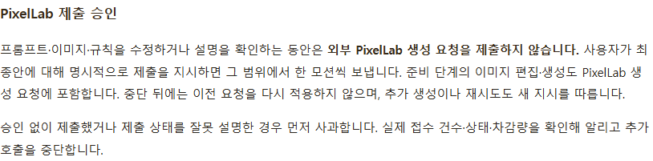

## 작업 결과

## 변경 내용

### 적용 내용

이전에 수정 과정의 기준 이미지 지시를 제출 승인으로 해석해 1건이 접수되고 2회 차감됐습니다. 프로젝트 지침에는 먼저 사과하고 사실·영향·현재 상태·조치를 보고하도록 했습니다. 가이드는 이미지 편집·애니메이션 모두 최종안 명시 지시 후만 제출하고, 중단 뒤 이전 요청을 재개하지 않도록 정했습니다.

## 검증

문서 빌드와 Edge에서 승인·오제출 대응 문구가 표시되는 것을 확인했습니다. 이번 작업에서 PixelLab 호출 없음.

## 남은 사항

실행 중인 다른 세션의 자동 재로딩 및 중앙 페이지 배포 상태 미확인.

## 작업 시간

- 제안 시간: 2~4분
- 실제로 완료된 시간: 01:37:35 KST 시작, 01:38:54 KST 확인 (1분 19초).
- XERJ: 미사용 — 사용자 지침에 따라 미사용.
