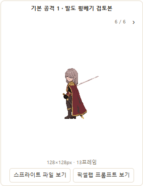

## 작업 결과

## 변경 내용

### 적용 내용

공급자 원본 PNG 13장을 아카이브 512×512 시트에 배치하고 기존 GIF 시간 정보를 사용했습니다. 실제 입력, 영문 프롬프트와 한글 번역, 요청 ID를 버전 기록에 연결했습니다.

## 검증

원본 ZIP 프레임 해시, 첫 프레임과 기준 도트의 RGBA 일치, 문서 빌드와 Edge의 6/6 표시·13프레임·이전 버전 전환·프롬프트 표시를 확인했습니다.

## 남은 사항

기존 버전과 게임 연결은 유지됩니다. 검토본은 270도 궤적과 끝 자세 왼손 동작 검수가 남았습니다. 이번 작업 PixelLab 호출 0건. 중앙 페이지 배포 미확인.

## 작업 시간

- 제안 시간: 3~5분
- 실제로 완료된 시간: 01:59:36 KST 시작, 02:01:28 KST 확인 (1분 52초).
- XERJ: 미사용 — 사용자 지침에 따라 미사용.
