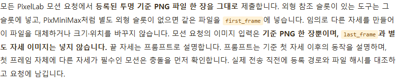

## 작업 결과

## 변경 내용

### 적용 내용

추가 끝 이미지를 안내하던 문구를 현행 규칙에 맞췄습니다. PixMiniMax는 기준 파일을 first_frame에 그대로 넣고 종료·중간 자세는 프롬프트로 설명합니다. 최종 명시적 제출 지시 이후에만 요청하는 절차를 유지합니다.

## 검증

문서 빌드 성공. Edge에서 등록된 투명 기준 PNG 한 장, last_frame 및 별도 자세 이미지 생략 문구를 확인했습니다. 이번 작업의 PixelLab 호출은 0건입니다.

## 남은 사항

중앙 배포와 기존 실행 중 세션의 자동 재로딩은 미확인입니다.

## 작업 시간

- 제안 시간: 2~4분
- 실제로 완료된 시간: 02:07:38 KST 시작, 02:08:40 KST 확인 (1분 2초).
- XERJ: 미사용 — 사용자 지침에 따라 미사용.
