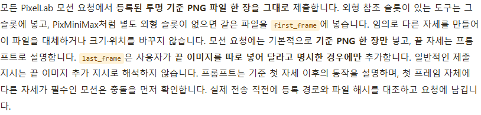

## 작업 결과

## 변경 내용

### 적용 내용

작업 지침과 캐릭터 제작 가이드 및 웹 가이드를 갱신했습니다.

## 검증

문서 빌드와 실제 웹 문구를 확인하고 스크린샷을 저장했습니다. PixelLab 호출 0회.

## 남은 사항

중앙 게시 후 접근 미확인.

## 작업 시간

- 제안 시간: 2~4분
- 실제로 완료된 시간: 약 3분 15초, 2026-11-21 02:10:53 KST 문서 및 확인 완료
- XERJ: 미사용 — 사용자 지침에 따라 미사용.
