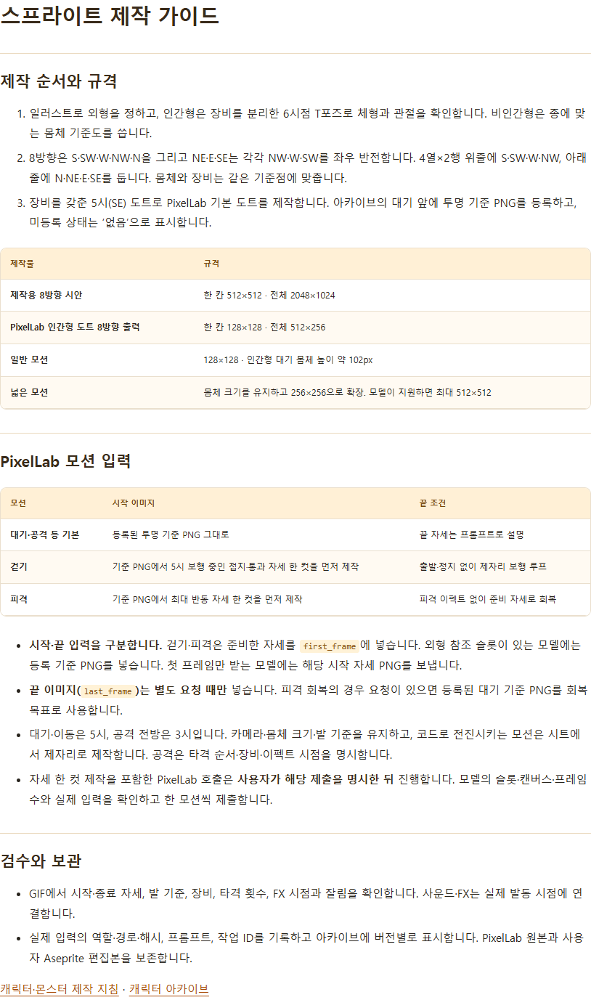

## 작업 결과

## 변경 내용

### 적용 내용

장교 개별 예시와 중복 설명을 제거했습니다. 피격 회복 끝 이미지는 명시 요청 때만 등록 대기 PNG를 사용하도록 기록했습니다.

## 검증

문서 빌드 후 실제 웹 가이드에서 공통 규격과 시작·끝 입력 문구를 확인하고 캡처했습니다. PixelLab 호출 0회.

## 남은 사항

중앙 보고서 웹 배포 미확인.

## 작업 시간

- 제안 시간: 2~4분
- 실제로 완료된 시간: 02:17:23 KST 시작, 02:18:36 KST까지 문서 및 화면 확인
- XERJ: 미사용 — 코드 검색 근거가 제공되지 않았습니다.
