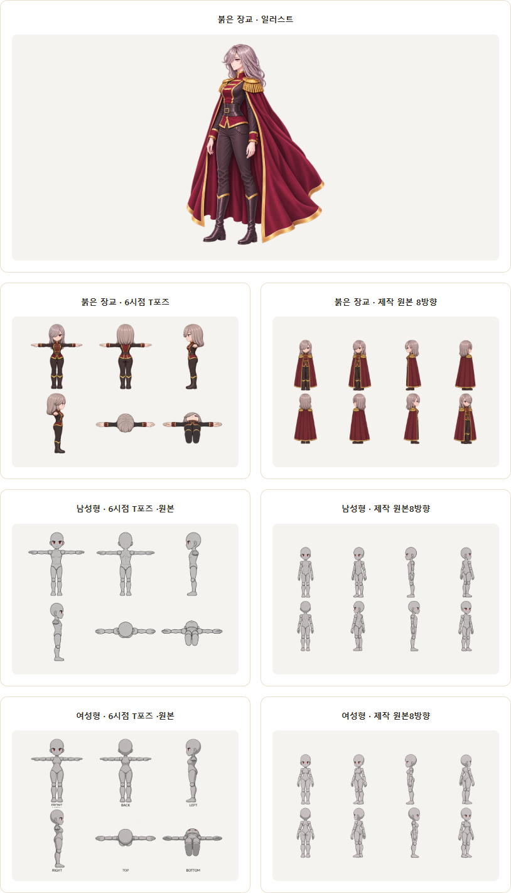

## 작업 결과

## 변경 내용

### 적용 내용

마네킹 T포즈와 8방향 및 캐릭터 일러스트·T포즈·8방향을 공통 가이드 상단에 배치했습니다.

## 검증

문서 빌드, 실제 웹 가이드의 원본 이미지 7장 로드, 모션 규칙 유지 확인.

## 남은 사항

중앙 보고서 페이지 배포 미확인.

## 작업 시간

- 제안 시간: 2~3분
- 실제로 완료된 시간: 30초, 02:20:01~02:20:31 KST 화면 확인
- XERJ: 미사용 — 코드 검색 근거가 제공되지 않았습니다.
