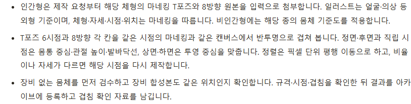

## 작업 결과

## 변경 내용

### 적용 내용

프로젝트 진입 지침, 제작 문서, 웹 가이드에 동일 작업 기준을 반영했습니다.

## 검증

문서 빌드와 실제 웹 가이드 문구를 확인했습니다.

## 남은 사항

기존 캐릭터 재제작 및 실행 중인 다른 세션 자동 반영은 미확인.

## 작업 시간

- 제안 시간: 2~4분
- 실제로 완료된 시간: 02:22:46 KST 시작, 02:23:22 KST 화면 검증
- XERJ: 미사용 — 코드 검색 근거가 제공되지 않았습니다.
