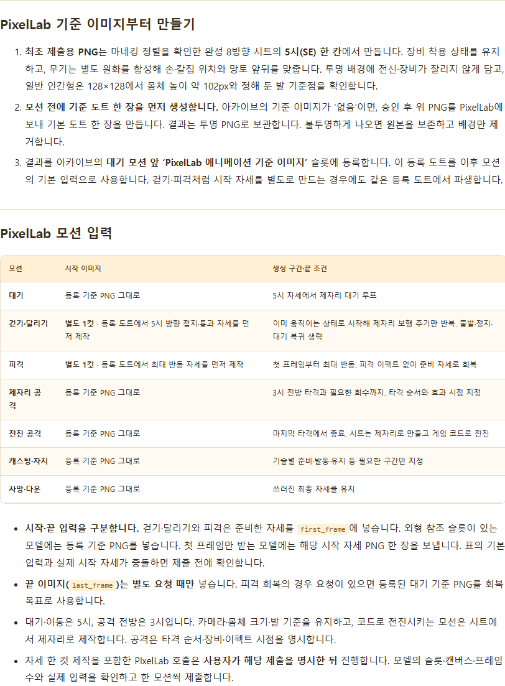

## 작업 결과

## 변경 내용

### 적용 내용

최초 제출 이미지 준비부터 기준 도트 등록까지 세 단계와 모션 7종 표를 보강했습니다.

## 검증

문서 빌드와 실제 웹 가이드의 표 7행, 별도 1컷 조건 및 끝 이미지 승인 문구를 확인했습니다. PixelLab 호출 0회.

## 남은 사항

중앙 보고서 페이지 배포 미확인.

## 작업 시간

- 제안 시간: 2~4분
- 실제로 완료된 시간: 02:24:48 KST 시작, 02:26 KST 웹 표시 검증
- XERJ: 미사용 — 코드 검색 근거가 제공되지 않았습니다.
