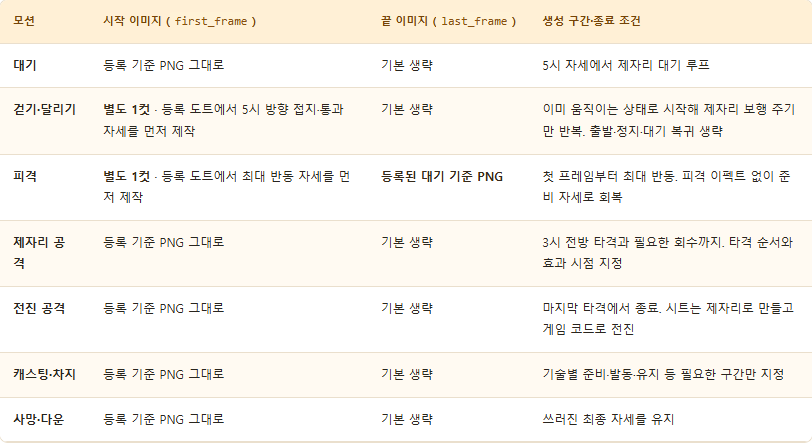

## 작업 결과

## 변경 내용

### 적용 내용

프로젝트 지침·제작 지침·모션 표의 피격 예외를 통일했습니다.

## 검증

빌드 후 피격 행과 다른 6종의 기본 생략을 확인했습니다. PixelLab 호출 0회.

## 남은 사항

중앙 보고서 배포 미확인.

## 작업 시간

- 제안 시간: 2~3분
- 실제로 완료된 시간: 02:35:50 KST 시작, 문서 빌드 및 실제 웹 표 검증 후 게시
- XERJ: 미사용 — 코드 검색 근거가 제공되지 않았습니다.
