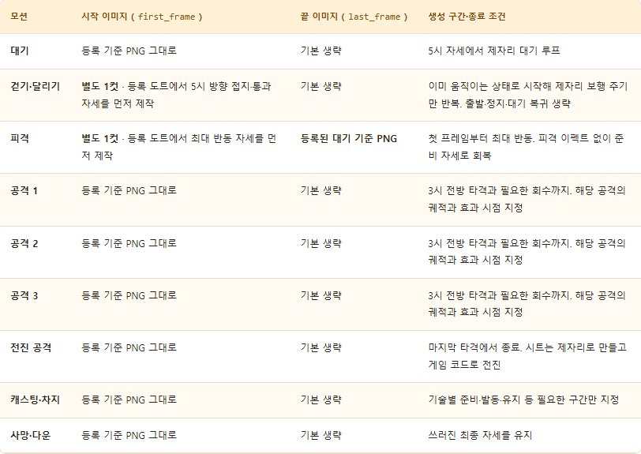

## 작업 결과

## 변경 내용

### 적용 내용

공통 가이드와 프로젝트 지침에 기본 공격 이미지·모션 최대 3종을 명시했습니다.

## 검증

문서 빌드와 웹 표의 정확한 항목명을 확인했습니다. PixelLab 호출 0회.

## 남은 사항

중앙 보고서 배포 미확인.

## 작업 시간

- 제안 시간: 2~3분
- 실제로 완료된 시간: 02:37:10 KST 시작, 빌드와 웹 표 검증 후 게시
- XERJ: 미사용 — 코드 검색 근거가 제공되지 않았습니다.
