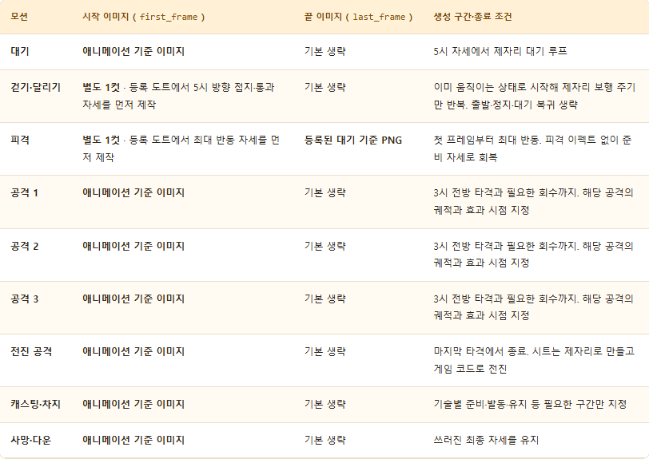

## 작업 결과

## 변경 내용

### 적용 내용

기록되지 않았습니다.

## 검증

문서 빌드와 실제 웹 표의 굵은 표기 7개를 확인했습니다.

## 남은 사항

보고서 페이지 배포 미확인.

## 작업 시간

- 제안 시간: 1~2분
- 실제로 완료된 시간: 02:38:29 KST 시작, 빌드와 웹 표 검증 후 게시
- XERJ: 미사용 — 코드 검색 근거가 제공되지 않았습니다.
