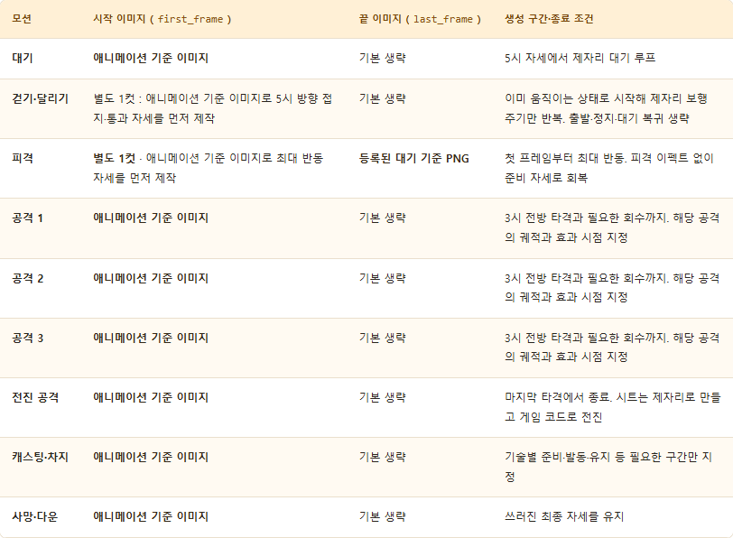

## 작업 결과

## 변경 내용

### 적용 내용

기록되지 않았습니다.

## 검증

문서 빌드 후 실제 웹 표의 두 칸을 대조하고 캡처했습니다.

## 남은 사항

중앙 보고서 배포 미확인.

## 작업 시간

- 제안 시간: 1~2분
- 실제로 완료된 시간: 02:40:30 KST 시작, 웹 표 확인 후 게시
- XERJ: 미사용 — 코드 검색 근거가 제공되지 않았습니다.
