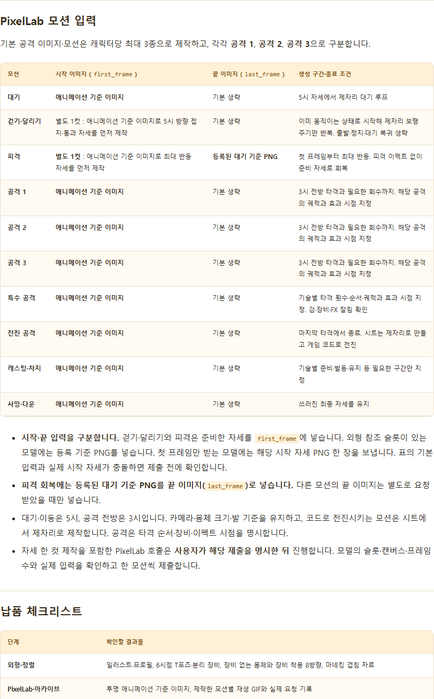

## 작업 결과

## 변경 내용

### 적용 내용

기존 장교 검격 사양은 공통 문서에서 캐릭터 README로 옮겼습니다.

## 검증

문서 빌드 후 실제 웹 가이드에서 특수 공격 행과 체크리스트를 확인했습니다.

## 남은 사항

중앙 보고서 배포 미확인.

## 작업 시간

- 제안 시간: 2~4분
- 실제로 완료된 시간: 02:44:40 KST 시작, 웹 가이드 검증 후 게시
- XERJ: 미사용 — 코드 검색 근거가 제공되지 않았습니다.
