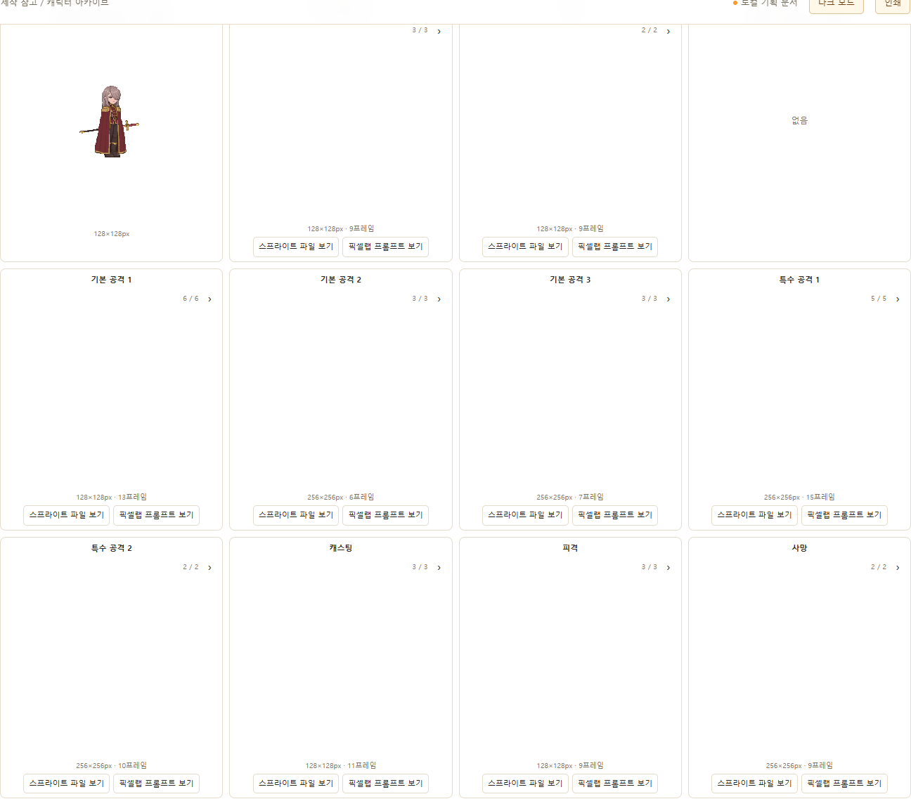

## 작업 결과

## 변경 내용

### 적용 내용

등록 이미지가 없는 카드는 없음으로 표시하도록 구성했습니다.

## 검증

문서 빌드 및 붉은 장교 아카이브의 슬롯과 공격 순서를 확인했습니다. 신규 이미지 생성 없음.

## 남은 사항

준비 자세 PNG 미등록. 중앙 보고서 페이지 배포 미확인.

## 작업 시간

- 제안 시간: 2~3분
- 실제로 완료된 시간: 02:58:38 KST 시작, 웹 확인 후 게시
- XERJ: 미사용 — 코드 검색 근거가 제공되지 않았습니다.
