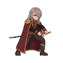
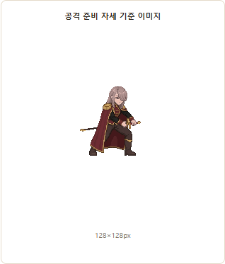

## 작업 결과

## 변경 내용

### 적용 내용

공격 준비 자세 기준 이미지 슬롯에 투명 128×128 PNG를 등록했습니다.

## 검증

입력 해시 일치, 공급자 결과 1장, PNG 알파 및 아카이브의 실제 128×128 이미지 로드를 확인했습니다. API 기록은 10회분입니다.

## 남은 사항

모션 생성 및 게임 적용은 이번 작업 범위에 포함되지 않습니다. 보고서 페이지 배포 미확인.

## 작업 시간

- 제안 시간: 3~5분
- 실제로 완료된 시간: 03:13:09 KST 시작, 03:16:36 KST 아카이브 표시 확인
- XERJ: 미사용 — 코드 검색 근거가 제공되지 않았습니다.
