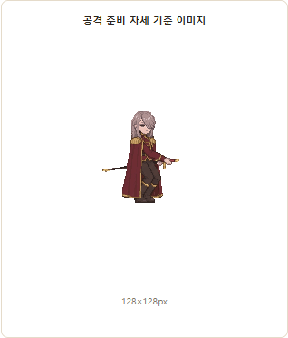

## 작업 결과

## 변경 내용

### 적용 내용

왼손은 검집 입구, 오른손은 검자루에 놓인 납도 상태로 재요청했습니다. 이전 PNG는 보존했습니다.

## 검증

PNG 128×128 및 투명 배경, 확대 육안 확인과 웹 슬롯 로드를 확인했습니다. 1건, 10회분 차감.

## 남은 사항

모션용 입력으로는 아직 사용하지 않았습니다. 중앙 보고서 배포 미확인.

## 작업 시간

- 제안 시간: 3~5분
- 실제로 완료된 시간: 03:21:07 KST 시작, 03:23:19 KST 웹 슬롯 검증
- XERJ: 미사용 — 코드 검색 근거가 제공되지 않았습니다.
