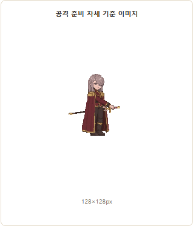

## 작업 결과

## 변경 내용

### 적용 내용

기록되지 않았습니다.

## 검증

실제 아카이브에서 128×128 PNG를 디코딩해 표시 경로를 확인했습니다. PixelLab 추가 호출 0회.

## 남은 사항

중앙 보고서 배포 미확인.

## 작업 시간

- 제안 시간: 1~2분
- 실제로 완료된 시간: 03:33:40 KST 시작, 슬롯 검증 후 게시
- XERJ: 미사용 — 코드 검색 근거가 제공되지 않았습니다.
