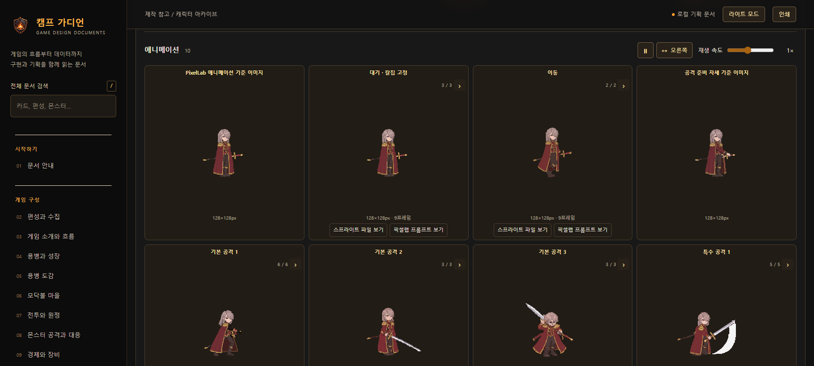

## 작업 결과

## 변경 내용

### 적용 내용

카드 제목과 미리보기 영역 간격 통일. 프로젝트 b28d8b53 푸시.

## 검증

문서 빌드와 브라우저에서 네 미리보기의 중심 높이가 일치하는 것을 확인.

## 남은 사항

중앙 배포 미확인.

## 작업 시간

- 제안 시간: 2~4분
- 실제로 완료된 시간: 약 51초, 03:38:38 KST 프로젝트 푸시.
- XERJ: 미사용 — 웹 빌드 및 수정한 PNG
