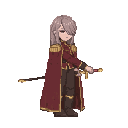

## 작업 결과

## 변경 내용

### 적용 내용

기록되지 않았습니다.

## 검증

등록 PNG 해시와 응답 0번 프레임 픽셀 일치, 웹 미리보기 로드, API 차감 2회분을 확인했습니다.

## 남은 사항

단발 360도 원형 검궤적이 미충족입니다. 512px 별도 PixelFX와 게임 적용은 미진행입니다. 보고서 배포 미확인.

## 작업 시간

- 제안 시간: 2~5분
- 실제로 완료된 시간: 03:42:49 KST 시작, 03:45:44 KST 웹 확인
- XERJ: 미사용 — 코드 검색 근거가 제공되지 않았습니다.
