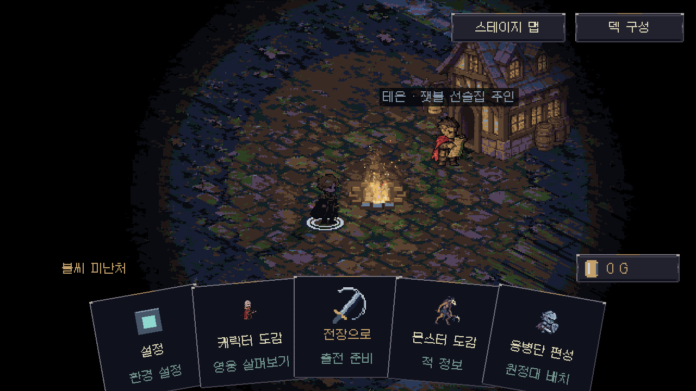

## 작업 결과

창 모드 고정과 1280×720 렌더 설정을 적용하고 프로젝트 main에 푸시했습니다.

## 변경 내용

### 적용 내용

게임 설정의 창 크기 선택을 고정 크기 표시로 교체했습니다. 기존 화면 좌표계와 전체 화면 옵션을 유지했습니다.

## 검증

Godot 4.7.2에서 기존 1배 저장 설정으로 창 1280×720, 캡처 1280×720, 창 크기 조절 비활성화를 확인했습니다. 마을과 설정 화면을 24프레임으로 기록했습니다.

## 남은 사항

Godot 편집기 내장 디버그 패널, 전투 화면 및 전체 화면 전환은 미확인입니다.

## 작업 시간

- 제안 시간: 3~5분
- 실제로 완료된 시간: 약 2분 20초, 03:49:13 KST 결과 확인
- XERJ: 미사용 — Godot 설정 및 실제 엔진 실행으로 확인
