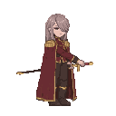

## 작업 결과

## 변경 내용

### 적용 내용

기록되지 않았습니다.

## 검증

등록 PNG와 응답 첫 이미지의 픽셀이 일치합니다. 128×128 총 5프레임과 재생 GIF, 사용량 1회분을 확인했습니다.

## 남은 사항

방향 고정 및 검격 FX 분리에 실패해 기존 게임과 아카이브 슬롯을 유지했습니다. 256px 별도 PixelFX는 미제작입니다.

## 작업 시간

- 제안 시간: 3~5분
- 실제로 완료된 시간: 03:55:37 KST 시작, 생성 결과와 사용량 확인 후 기록
- XERJ: 미사용 — 코드 검색 근거가 제공되지 않았습니다.
