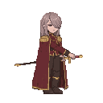

## 작업 결과

## 변경 내용

### 적용 내용

기록되지 않았습니다.

## 검증

128×128 원본 5프레임, 입력 첫 프레임 픽셀 일치와 GIF 재생, 작업 소모량 1회분을 확인했습니다.

## 남은 사항

덧그려진 검궤적이 있고 검집 이동·눈 가림·완전 납도가 불분명합니다. 현행 아카이브와 게임 적용본은 유지했습니다.

## 작업 시간

- 제안 시간: 2~5분
- 실제로 완료된 시간: 04:07:48 KST 시작, 04:08:31 KST 프레임 및 잔여량 확인
- XERJ: 미사용 — 코드 검색 근거가 제공되지 않았습니다.
