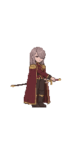

## 작업 결과

## 변경 내용

### 적용 내용

기록되지 않았습니다.

## 검증

지정 크기와 입력 첫 프레임 픽셀 일치, GIF 재생, 작업 소모량 1회분을 확인했습니다. 초반 디딤과 숙임, 후반 검 위치 변화가 보이며 검격 효과가 없습니다.

## 남은 사항

눈을 가리는 그림자와 완전히 고정된 자세는 선명하지 않습니다. 기존 캐릭터 아카이브 및 게임 적용본을 유지했습니다.

## 작업 시간

- 제안 시간: 2~5분
- 실제로 완료된 시간: 04:13:32 KST 시작, 04:14:51 KST 프레임과 사용량 확인
- XERJ: 미사용 — 코드 검색 근거가 제공되지 않았습니다.
