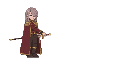

## 작업 결과

## 변경 내용

### 적용 내용

기록되지 않았습니다.

## 검증

지정된 크기와 총 9프레임, 첫 이미지 픽셀 일치, GIF 재생 및 실제 소모 1회분을 확인했습니다.

## 남은 사항

보폭과 후반 자세·검집 고정, 눈을 가리는 그림자 표현이 미흡합니다. 캐릭터 아카이브와 게임 적용본은 유지했습니다.

## 작업 시간

- 제안 시간: 2~5분
- 실제로 완료된 시간: 04:18:35 KST 시작, 04:19:57 KST 결과 및 잔여량 확인
- XERJ: 미사용 — 코드 검색 근거가 제공되지 않았습니다.
