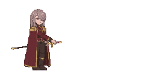

## 작업 결과

## 변경 내용

### 적용 내용

기록되지 않았습니다.

## 검증

총 9프레임과 첫 입력 픽셀 일치 및 GIF 재생을 확인했습니다. 벤 이펙트가 없고 낮은 자세가 전보다 뚜렷합니다. 1회분 소모.

## 남은 사항

후반 장비 움직임과 끝 프레임의 노출된 검날 때문에 검집 고정 및 완전 납도 조건을 충족하지 못했습니다.

## 작업 시간

- 제안 시간: 2~5분
- 실제로 완료된 시간: 04:22:05 KST 시작, 04:22:56 KST 결과 검수
- XERJ: 미사용 — 코드 검색 근거가 제공되지 않았습니다.
