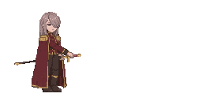

## 작업 결과

## 변경 내용

### 적용 내용

기록되지 않았습니다.

## 검증

총 9프레임과 첫 입력 픽셀 일치, GIF 재생을 확인했습니다. 깊은 런지와 눈 그림자가 이전보다 뚜렷합니다. 작업 기록상 1회분 소모.

## 남은 사항

머리카락은 전진 때 움직이고 마지막에 검날이 노출됩니다. 수정된 프롬프트로 추가 제출하지 않았습니다.

## 작업 시간

- 제안 시간: 2~5분
- 실제로 완료된 시간: 04:25:09 KST 시작, 04:25:55 KST 결과 확인
- XERJ: 미사용 — 코드 검색 근거가 제공되지 않았습니다.
