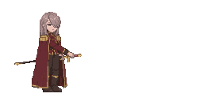

## 작업 결과

## 변경 내용

### 적용 내용

기록되지 않았습니다.

## 검증

총 9프레임, 입력 첫 이미지 일치, GIF 재생, 실제 사용량 1회분을 확인했습니다. 전진, 숙임, 눈 그림자, 머리 움직임이 보입니다.

## 남은 사항

후반 검 위치가 크게 바뀌고 마지막까지 뒤로 검날이 노출됩니다. 검토본으로 보관했습니다.

## 작업 시간

- 제안 시간: 2~5분
- 실제로 완료된 시간: 04:29:02 KST 시작, 04:30:05 KST 결과 검수
- XERJ: 미사용 — 코드 검색 근거가 제공되지 않았습니다.
