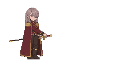

## 작업 결과

## 변경 내용

### 적용 내용

기록되지 않았습니다.

## 검증

입력 첫 이미지 일치, 17프레임과 GIF 재생, 실제 1회분 소모 확인. 머리 전체의 급격한 명암 변화는 없고 검·검집은 납도 상태입니다.

## 남은 사항

전진과 숙임이 얕고 검집 각도에 미세한 차이가 있습니다. 검토본으로 보관했습니다.

## 작업 시간

- 제안 시간: 2~5분
- 실제로 완료된 시간: 04:42:53 KST 시작, 04:44:17 KST 결과 확인
- XERJ: 미사용 — 코드 검색 근거가 제공되지 않았습니다.
