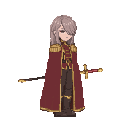

## 작업 결과

## 변경 내용

### 적용 내용

기록되지 않았습니다.

## 검증

25개 공급자 프레임과 첫 프레임 일치, 파지 후보인 25번째 프레임에 나비 분리 시작, GIF 재생과 소모량 3회분을 확인했습니다.

## 남은 사항

호흡과 검집을 잡는 순간이 미세하며 끝 프레임은 지정 PNG와 픽셀 단위로 일치하지 않습니다. 게임 적용은 미진행입니다.

## 작업 시간

- 제안 시간: 3~6분
- 실제로 완료된 시간: 05:05:46 KST 시작, 05:10:12 KST 합성 GIF 확인
- XERJ: 미사용 — 코드 검색 근거가 제공되지 않았습니다.
