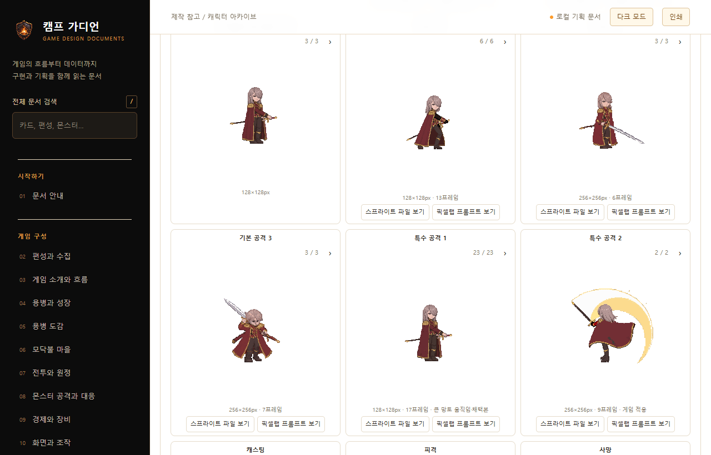

## 작업 결과

## 변경 내용

### 적용 내용

최신순 버전 그리드, 선택 강조, 기존 화살표 유지. 프로젝트 2cc7d5de 푸시.

## 검증

문서 빌드 및 Chrome에서 특수 공격 버전 23개 표시와 18번 직접 선택 확인.

## 남은 사항

중앙 배포 미확인.

## 작업 시간

- 제안 시간: 4~7분
- 실제로 완료된 시간: 약 1분 47초, 05:35:47 KST 프로젝트 푸시.
- XERJ: 미사용 — 웹 빌드 및 수정한 PNG
